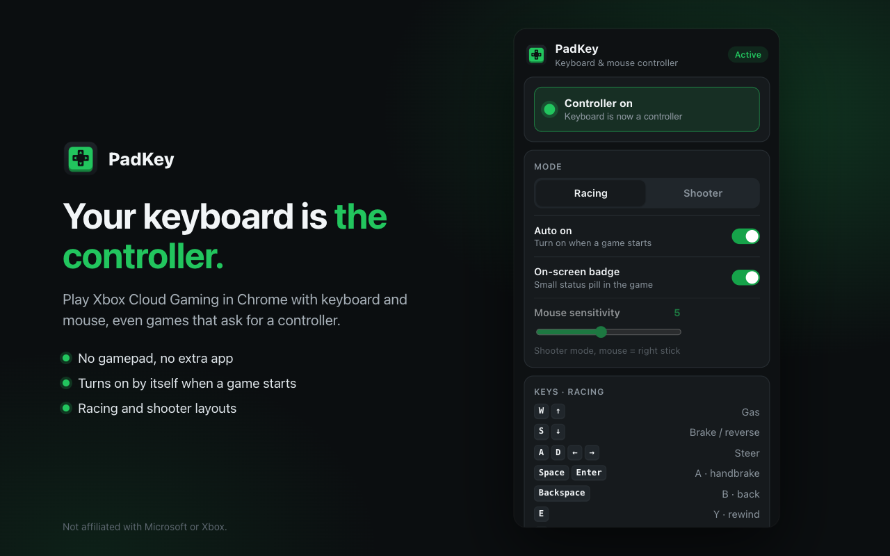

# PadKey (xCloud Keyboard Gamepad)

Play **any** Xbox Cloud Gaming game on `play.xbox.com` with keyboard and mouse, even games that need a controller (Forza Horizon 6, etc.). It adds a virtual Xbox controller in the browser. No real gamepad, no extra app.

Tested in Chrome on macOS with the new `play.xbox.com` client (2026).

> Better xCloud does not work on the new `play.xbox.com` page and can break it. Turn it off while using this.

## Install

Pick **one**.

### Option A: PadKey Chrome extension (recommended)

Settings popup, on-screen badge, mouse sensitivity, auto on.

1. Download `padkey-chrome-<version>.zip` from the [latest release](https://github.com/subscriptions-dot/xcloud-keyboard-gamepad/releases/latest) and unzip it.
2. Open `chrome://extensions`, turn on **Developer mode**.
3. **Load unpacked** > choose the unzipped folder.

Source: [`chrome-extension/`](chrome-extension). Chrome Web Store listing: coming soon.

### Option B: Tampermonkey (userscript)

1. Install [Tampermonkey](https://www.tampermonkey.net/) in Chrome.
2. `chrome://extensions` > Tampermonkey > Details > turn on **Allow user scripts**.
3. Open [`xcloud-keyboard-gamepad.user.js`](https://raw.githubusercontent.com/subscriptions-dot/xcloud-keyboard-gamepad/main/xcloud-keyboard-gamepad.user.js) and click **Install**.

Tampermonkey updates it by itself from this repo.

Use only one option. If you use the extension, turn the Tampermonkey script off.

Privacy: [PRIVACY.md](PRIVACY.md). PadKey collects no data.

## Use

1. Open `play.xbox.com` and start a game.
2. The virtual controller turns **ON by itself** when the game starts. A green toast says *Keyboard gamepad ON*.
3. If the game says "Controller Disconnected" or "Connect a controller", wait 2 seconds and press `Enter`.

| Key | Action |
| --- | --- |
| `` ` `` | Virtual controller ON / OFF. Key just left of `1` (below `Esc`). On Indian/UK Mac keyboards it can be the `§` key there, both work. |
| `\` | Switch mode: racing / shooter |

### Racing mode (default)

| Key | Controller |
| --- | --- |
`W A S D` and the arrow keys do the same thing. Use whichever you like.

| Key | Controller |
| --- | --- |
| `W` or `↑` | RT (gas) + stick up (menus) |
| `S` or `↓` | LT (brake / reverse) + stick down (menus) |
| `A` / `D` or `←` / `→` | Left stick (steer, menus) |
| `Space`, `Enter` | A |
| `Backspace` | B |
| `Q` | X |
| `E` | Y |
| `Shift` | RB |
| `Ctrl` | LB |
| `R` | Right stick click |
| `I` `J` `K` `L` | D-pad up / left / down / right |
| `Tab` | Menu / Start |
| `G` | View / Back |

### Shooter mode

| Key | Controller |
| --- | --- |
| `W A S D` or arrow keys | Left stick |
| Mouse | Right stick (click screen first to lock mouse) |
| Left click | RT |
| Right click | LT |
| `Space` | A |
| `C` | B |
| `R` | X |
| `E` | Y |
| `Q` / `F` | LB / RB |
| `Shift` | Left stick click |
| `V` | Right stick click |
| `I J K L`, `Enter`, `Backspace`, `Tab`, `G` | same as racing |

Tip for racing on keyboard: pick **Assisted Steering and Braking**, keyboard steering is all-or-nothing.

## How it works

The new `play.xbox.com` stream client does not poll `navigator.getGamepads()` every frame. It listens for Chrome's `gamepadrawinputchanged` event. That is why older scripts that only patch `getGamepads()` show "Controller not detected".

This script:

1. Patches `navigator.getGamepads()` to add a virtual "standard" Xbox 360 pad driven by the keyboard and mouse.
2. Sends a `focus` event every 2 seconds while ON. The Xbox UI only tracks gamepads after a focus event, and the stream re-reads connected pads on focus (otherwise a game started later shows "Controller Disconnected").
3. Sends `gamepadconnected`, then a `gamepadrawinputchanged` event on every key change and every frame, which is what the stream reads.
4. Stops mapped keys from reaching the Xbox page, so `Enter` does not also open the Xbox guide.

## Known limits

- Keyboard steering and throttle are digital (full on / off).
- Mouse look in shooter mode is basic, sensitivity is `MOUSE_SENS` in the script.
- If Microsoft changes the stream client, this can break.
- Not affiliated with Microsoft or Xbox.

## License

MIT
